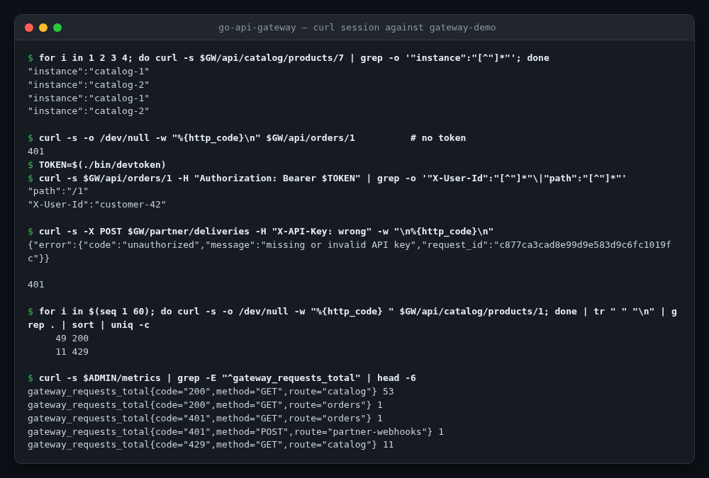
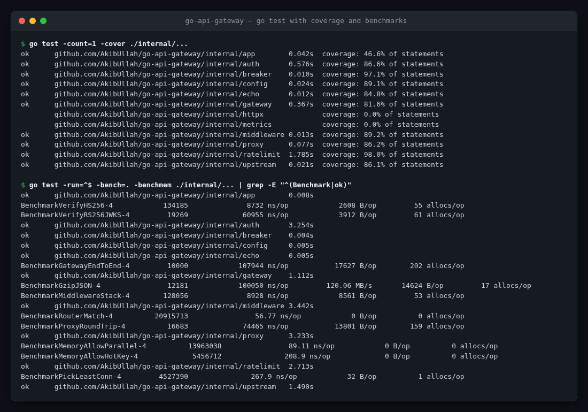
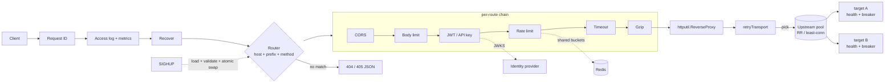

<!-- topics: go,golang,api-gateway,reverse-proxy,rate-limiting,circuit-breaker,jwt,prometheus,redis,microservices -->
# go-api-gateway

A reverse-proxy API gateway in Go: YAML-configured routes and upstream pools with health checks, load balancing, retries and circuit breakers, plus JWT/JWKS and API-key auth, token-bucket rate limiting (memory or Redis), CORS, gzip, Prometheus metrics and zero-downtime config reload.

[](https://github.com/AkibUllah/go-api-gateway/actions/workflows/ci.yml)
[](https://github.com/AkibUllah/go-api-gateway/actions/workflows/codeql.yml)
[](https://github.com/AkibUllah/go-api-gateway/releases)


## Try it live

| | |
|---|---|
| Run in your browser | [](https://codespaces.new/AkibUllah/go-api-gateway?quickstart=1) — runs `docker compose up` (gateway, two catalog replicas, an orders service, Redis); open forwarded port 8080 at `/api/catalog/products/7`, and 9090 at `/metrics`. Mint a token with `make token`. |
| One-click deploy | [](https://render.com/deploy?repo=https://github.com/AkibUllah/go-api-gateway) — `render.yaml` runs `gateway-demo` (the gateway plus in-process demo upstreams) on a free web service; `JWT_SECRET` and `PARTNER_API_KEY` are generated, read them from the service's environment tab. |
| Local | `docker compose up` or `make demo` (see Quick Start) |

There is no GitHub Pages site for this repo: the gateway is a network service, and the Codespace or Render deploy is the real thing.

## Screenshots



*A real session against `gateway-demo` (gateway plus in-process upstreams): round-robin across the two catalog replicas, `401` without a JWT, the `X-User-Id` claim header the orders upstream receives with one, a rejected partner API key, the per-IP token bucket returning `429` after its burst, and the resulting Prometheus counters.*



*`go test -cover` per package and the benchmark suite on a 4-core laptop.*

## Why this exists

In the payment and e-commerce systems I have worked on, every service eventually grows the same edge code: check the token, throttle the noisy client, retry the flaky dependency, stop calling it when it is down, log a request ID that links all of it together. Done per service it drifts and gets subtly wrong (trusting a spoofed `X-Forwarded-For` for rate limiting is the classic). This gateway puts that edge in one small Go binary built on `net/http` and `httputil.ReverseProxy`, with four direct dependencies, so the behaviour is easy to read, test and reason about under load.

## Features

- **Routing**: host match (exact or `*.example.com`) and longest path-prefix match on segment boundaries, method filters with proper `405` + `Allow`, optional prefix stripping
- **Upstream pools**: round-robin or least-connections, active health checks with healthy/unhealthy thresholds, per-target circuit breaker (closed → open → half-open probes)
- **Retries**: idempotent, bodiless requests are retried on a *different* target after connection errors or 502/503/504, with backoff, inside the route's overall timeout
- **Auth**: JWT (HS256/384/512, RS256/384/512 from a PEM file or a JWKS URL with caching, rotation and fetch throttling), issuer/audience/expiry checks, claims forwarded as headers; API keys stored as SHA-256 digests and compared in constant time
- **Rate limiting**: token bucket per client IP, authenticated consumer or any header; sharded in-memory buckets or an atomic Lua script in Redis shared by all replicas; `RateLimit-*` and `Retry-After` headers; fail-open or fail-closed when Redis is down
- **Edge hygiene**: request IDs (kept from a trusted edge or generated), `X-Forwarded-For` honoured only from trusted proxies, body size limits, per-route timeouts mapped to `504`, CORS with credential-safe origin echo, gzip that skips small, binary, pre-encoded and SSE responses, JSON error envelope
- **Operations**: structured `slog` access logs, Prometheus metrics, `/healthz` and `/readyz` (fails while draining or when a pool has no healthy target), `SIGHUP` hot reload that keeps the old config if the new one is invalid, graceful shutdown with a drain delay
- **Packaging**: static binaries on distroless (37 MB image, non-root), compose stack with Redis and demo upstreams, `-check` to validate configs in CI, `-healthcheck` for container probes

## Architecture



Design notes:

- **The middleware order is fixed; routes only switch pieces on.** CORS runs before auth so preflights never need a token; auth runs before rate limiting so `key: consumer` can limit per user; the timeout wraps the whole retry loop, so retries cannot stretch a request past its budget.
- **Retries live in the transport, not the handler.** `ReverseProxy` keeps doing what it is good at (hop-by-hop headers, streaming, WebSocket upgrades) while `retryTransport` chooses a target per attempt, excludes targets already tried and only replays requests without a body, so a `POST` is never sent twice.
- **Health and circuit state are separate signals.** Active checks decide whether a target is in rotation; the breaker reacts to live traffic within seconds. A client hanging up is recorded as neither success nor failure, so impatient clients cannot trip a breaker.
- **Reload is a pointer swap.** Each config is compiled into an immutable runtime (router, pools, limiters, verifiers) and stored in an `atomic.Pointer`. In-flight requests finish on the old runtime, which releases its connections after a grace period. Metrics live outside the runtime so counters survive reloads.
- **Client IP is resolved once, conservatively.** `X-Forwarded-For` is walked right-to-left and the first hop that is not a trusted proxy wins; from an untrusted peer the header is ignored and not forwarded, so rate limits and logs cannot be spoofed.

## Tech Stack

| Concern | Choice |
| --- | --- |
| Language / HTTP | Go 1.26, `net/http`, `net/http/httputil`, `log/slog` |
| Config | YAML (`gopkg.in/yaml.v3`, strict decoding) with `${VAR:-default}` expansion |
| Auth | `github.com/golang-jwt/jwt/v5`; JWKS client and API keys in-house |
| Rate limiting | in-process sharded token buckets; Redis via `github.com/redis/go-redis/v9` + Lua |
| Metrics | `github.com/prometheus/client_golang` |
| Tests | `testing`, `httptest`, `miniredis`, race detector |
| Tooling | golangci-lint v2, Makefile, multi-stage Dockerfile (distroless), GitHub Actions |

## Quick Start

### Docker Compose (gateway + 3 echo upstreams + Redis)

```bash
git clone https://github.com/AkibUllah/go-api-gateway.git && cd go-api-gateway
docker compose up -d --build
curl -s localhost:8080/api/catalog/products/7 | jq '{instance, path}'   # alternates catalog-1 / catalog-2
curl -s localhost:9090/readyz
```

### Local (Go 1.26+, no Docker)

```bash
make demo        # gateway on :8080, admin on :9090, demo upstreams on 127.0.0.1:9001-9003
```

Then exercise each route of [`configs/gateway.yaml`](configs/gateway.yaml):

```bash
# Public catalogue: prefix stripped, round-robin, gzip for large bodies, 20 req/s per IP
curl -s -H 'Accept-Encoding: gzip' -D - -o /dev/null 'localhost:8080/api/catalog/products?size=8000'

# Customer orders need a JWT; the upstream receives X-User-ID / X-User-Role from the claims
curl -s -i localhost:8080/api/orders/mine | head -1                    # 401
TOKEN=$(go run ./cmd/devtoken -sub customer-42)
curl -s -H "Authorization: Bearer $TOKEN" localhost:8080/api/orders/mine | jq .headers

# Courier partners post with an API key (removed before forwarding)
curl -s -X POST -H 'X-API-Key: demo-partner-key' -d '{"awb":"DHK-20931"}' localhost:8080/partner/delivery-status

# Make an upstream fail and watch retries and the breaker in /metrics
curl -s 'localhost:8080/api/catalog/x?status=503' -o /dev/null -w '%{http_code}\n'
curl -s localhost:9090/metrics | grep -E 'gateway_(upstream_retries|circuit_state)'

# Edit configs/gateway.yaml, then reload without dropping connections
kill -HUP "$(pgrep -f 'bin/gateway-demo')"
```

The demo upstreams reflect whatever they receive, and accept `?status=`, `?delay=` and `?size=` to simulate failures, slowness and large payloads.

## Configuration

One YAML file, validated strictly at startup and on every reload (unknown keys, dangling references, short HMAC secrets and invalid CIDRs are all errors, reported together). `gateway -config file.yaml -check` runs the same validation in CI.

```yaml
upstreams:
  catalog:
    balancer: round_robin            # or least_conn
    targets: ["${CATALOG_1_URL:-http://127.0.0.1:9001}", "${CATALOG_2_URL:-http://127.0.0.1:9002}"]
    health_check: {path: /health, interval: 5s, timeout: 1s, healthy_threshold: 2, unhealthy_threshold: 2}
    circuit_breaker: {failure_threshold: 5, open_timeout: 15s}
    retries: {attempts: 1, backoff: 20ms}          # on 502/503/504 and connection errors

jwt:
  customers:
    secret: "${JWT_SECRET}"                        # or public_key_file / jwks_url
    issuer: https://auth.dokan.local
    audience: dokan-api
    forward_claims: {sub: X-User-ID, role: X-User-Role}

rate_limits:
  per_customer: {rate: 60, period: 1m, burst: 10, key: consumer, backend: redis}

routes:
  - name: orders
    path_prefix: /api/orders
    strip_prefix: true
    upstream: orders
    timeout: 10s
    max_body_bytes: 256KB
    jwt: customers
    rate_limit: per_customer
```

| Key | Purpose |
| --- | --- |
| `server` | `listen`, read/write/idle timeouts, `default_timeout`, `max_body_bytes`, `trusted_proxies`, health/ready paths |
| `admin` | separate listener for `/metrics`, `/healthz`, `/readyz` (`listen: ""` serves them on the main port) |
| `upstreams.<name>` | `targets`, `balancer`, `health_check`, `circuit_breaker`, `retries`, `dial_timeout`, `max_idle_conns_per_host` |
| `jwt.<name>` | `algorithms`, one of `secret` / `public_key_file` / `jwks_url`, `jwks_cache_ttl`, `issuer`, `audience`, `leeway`, `forward_claims` |
| `api_keys.<name>` | `header` and `keys` (`key` from env, or `sha256` digest) |
| `rate_limits.<name>` | `rate` per `period`, `burst`, `key` (`ip`, `consumer`, `header:<Name>`), `backend` (`memory`, `redis`) |
| `cors.<name>` | origins (exact, `*.domain`, `*`), methods, headers, exposed headers, credentials, max age |
| `routes[]` | `host`, `path_prefix`, `methods`, `strip_prefix`, `upstream`, `timeout`, `max_body_bytes`, `jwt` or `api_keys`, `rate_limit`, `cors`, `gzip` |

`${VAR}` without a default must be set, so a missing secret stops startup instead of becoming an empty string.

## Endpoints and headers

| Path | Listener | Purpose |
| --- | --- | --- |
| `/healthz` | public + admin | Liveness: the process is serving |
| `/readyz` | public + admin | Readiness: `503` while draining or when any pool has no healthy target; JSON per-pool counts |
| `/metrics` | admin (or public if `admin.listen` is empty) | Prometheus |
| everything else | public | Routed by `routes[]` |

Errors produced by the gateway itself share one shape: `{"error": {"code": "rate_limited", "message": "too many requests", "request_id": "…"}}` with codes `route_not_found`, `method_not_allowed`, `unauthorized`, `rate_limited`, `body_too_large`, `upstream_timeout`, `no_healthy_upstream`, `bad_gateway`.

Headers added upstream: `X-Request-ID`, `X-Forwarded-For/Host/Proto`, `X-Consumer-ID`, configured claim headers (client-sent copies are always stripped). Headers added downstream: `X-Request-ID`, `RateLimit-Limit`, `RateLimit-Remaining`, `Retry-After`, CORS headers.

Metrics: `gateway_requests_total{route,method,code}`, `gateway_request_duration_seconds{route}`, `gateway_in_flight_requests`, `gateway_upstream_requests_total{upstream,target,outcome}`, `gateway_upstream_retries_total`, `gateway_upstream_target_healthy`, `gateway_circuit_state`, `gateway_rate_limited_total`, `gateway_auth_failures_total`, `gateway_config_reloads_total{result}`, plus Go runtime and process collectors.

## Benchmarks

`make bench` on a 4-core Intel i5-6200U laptop (2.3 GHz, Go 1.26.10, load average ~4 from other work during the run). Parallel benchmarks use all 4 cores; the two network benchmarks run the client, the gateway and the upstream on the same machine over loopback TCP, so they measure the whole loop, not the gateway alone.

| Benchmark | ns/op | B/op | allocs/op | What it measures |
| --- | ---: | ---: | ---: | --- |
| `RouterMatch` | 55 | 0 | 0 | longest-prefix match over 10 routes |
| `MemoryAllowParallel` | 89 | 0 | 0 | token bucket, 10k client keys, 4 goroutines |
| `MemoryAllowHotKey` | 215 | 0 | 0 | token bucket, every goroutine on one key (worst case) |
| `PickLeastConn` | 263 | 32 | 1 | target selection + breaker + in-flight accounting |
| `VerifyHS256` | 8,728 | 2,608 | 55 | parse and validate an HS256 JWT |
| `VerifyRS256JWKS` | 61,601 | 3,912 | 61 | RS256 JWT with a cached JWKS key |
| `MiddlewareStack` | 10,031 | 8,562 | 53 | request id, access log, metrics, recover, CORS, body limit, rate limit, timeout (parallel) |
| `GzipJSON` | 94,635 (127 MB/s) | 14,372 | 17 | compress a 12 KB JSON body |
| `ProxyRoundTrip` | 71,015 | 13,768 | 159 | client → ReverseProxy + retry transport → upstream, parallel |
| `GatewayEndToEnd` | 86,072 | 17,633 | 202 | full stack over TCP (router, middleware, rate limit, proxy), parallel: ~11.6k req/s |

The gateway's own overhead over a bare `ReverseProxy` hop is roughly the difference between the last two rows (~15 µs, mostly logging and metrics). RS256 verification dominates when it is enabled; HS256 or API keys keep auth under 10 µs.

## Project Structure

```
cmd/
├── gateway/          # the gateway binary
├── gateway-demo/     # gateway + in-process demo upstreams (Render, quick try-out)
├── echo-upstream/    # demo upstream used by docker compose
└── devtoken/         # mints HS256 tokens for the demo config
internal/
├── app/              # flags, listeners, signal handling (SIGHUP reload, SIGTERM drain)
├── config/           # YAML schema, ${VAR:-default} expansion, defaults, validation
├── gateway/          # compiles a config into a runtime, atomic reload, health/ready, Serve
├── proxy/            # router (host/prefix/method) and ReverseProxy + retrying transport
├── upstream/         # pools, round-robin / least-conn, active health checks
├── breaker/          # consecutive-failure circuit breaker
├── middleware/       # request id, access log, recover, CORS, body limit, auth, rate limit, timeout, gzip
├── auth/             # JWT verifier, JWKS cache, API keys
├── ratelimit/        # token bucket: sharded memory, Redis Lua
├── metrics/          # Prometheus collectors
├── httpx/            # JSON errors, client IP, status recorder, request context
└── echo/             # demo upstream handler
configs/gateway.yaml  # demo config for a fictional Dhaka shop
```

## Testing

```bash
make race     # go test -race ./...
make lint     # golangci-lint v2 (gosec, errorlint, revive, bodyclose, noctx, ...)
make bench
```

82 test functions (111 including subtests) across 10 packages, 86.8% statement coverage of `internal/`, all against real `httptest` servers and listeners rather than mocks of `net/http`. Covered: config parsing, env expansion, byte sizes and every cross-reference rule; breaker transitions with an injected clock; round-robin and least-connections distribution, health thresholds and target exclusion; token buckets on both backends (burst, refill, cap, independence, exact counts under 20 concurrent goroutines, Redis TTLs and shared state across replicas via miniredis); JWT expiry, issuer, audience, `alg: none` and RS/HS confusion, JWKS caching, rotation, throttling and stale-key fallback; API key digests; CORS origin matching including look-alike domains; gzip negotiation and skip rules; spoofed claim, consumer and `X-Forwarded-For` headers; retries on status and connection errors (and none for `POST`), circuit shedding, route timeouts, client cancels; end-to-end routing, auth, rate limits, readiness, metrics output, atomic reload, failed reload keeping the old config and graceful shutdown completing an in-flight request.

## Roadmap

- [ ] Weighted targets and slow-start for newly healthy instances (#1)
- [ ] OpenTelemetry tracing (W3C `traceparent` propagation and spans per upstream attempt) (#2)
- [ ] Request/response header rewrite rules and path rewrites beyond prefix stripping (#3)
- [ ] mTLS to upstreams and TLS termination with certificate reload (#4)
- [ ] Outlier detection that ejects targets based on live error rates, not only active checks (#5)

## License

MIT — see [LICENSE](LICENSE).
